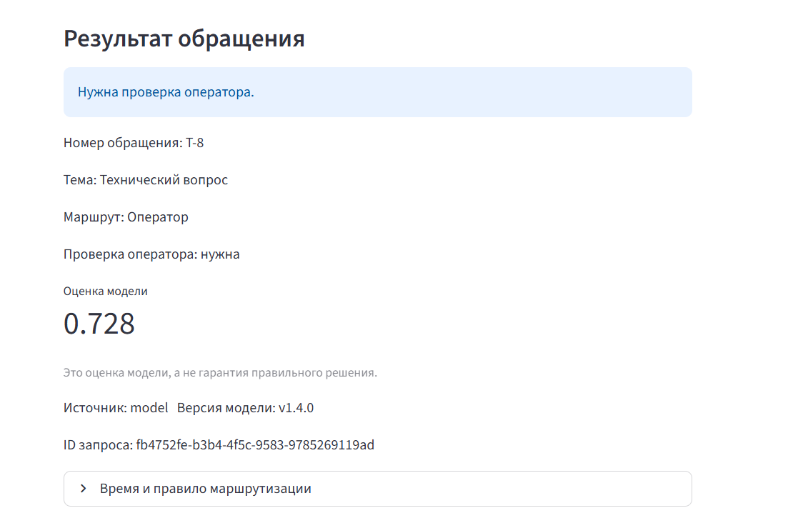
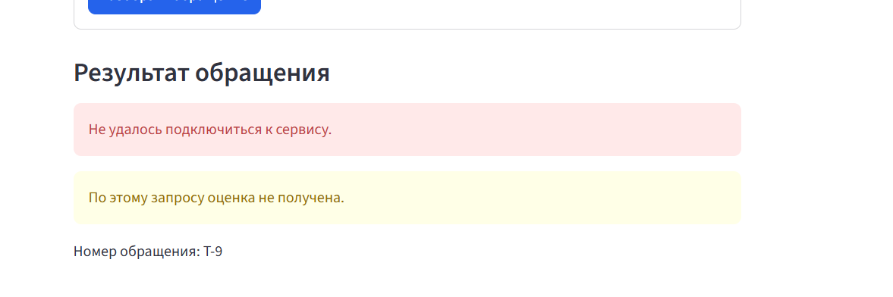
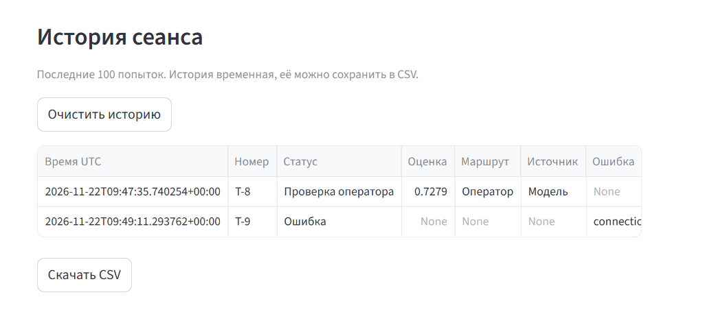
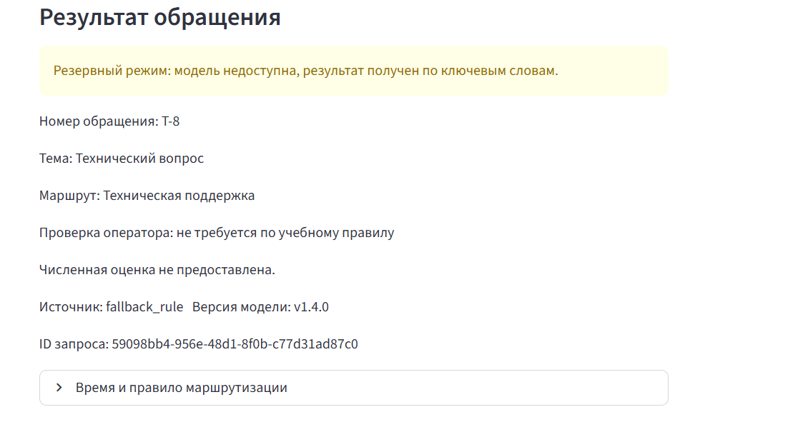

# ЛР 8. Пользовательское приложение Smart Helpdesk

## Цель

Сделать сервис маршрутизации обращений доступным через форму. Пользователь вводит текст и получает понятный результат без ручной работы с JSON.

## Связь с ЛР 7

Использован существующий POST /api/v1/predict. Модель LogisticRegression v1.4.0 и TF-IDF из ЛР 4 остаются на сервере lab5. Контракт сервера не менялся. В интерфейсе нет загрузки joblib или прямого вызова модели.

Тема № 4 сохранена. Поля примера методички для оборудования заменены полями обращений: ticket_id, text и channel. Модель определяет TECHNICAL, PAYMENT или STUDY, затем предлагается отдел либо очередь оператора.

## Компоненты и контракт

Форма Streamlit вызывает отдельный HTTP-клиент. Затем FastAPI проверяет токен, право, квоту и вход, вызывает адаптер и возвращает JSON. Клиент проверяет структуру и согласованность ответа до отображения. Подробности приведены в lab8_architecture.md.

| Файл | Назначение |
|---|---|
| frontend/app.py | Форма, состояния и отображение результата |
| frontend/api_client.py | HTTP-запросы, таймауты и безопасные ошибки |
| frontend/request_validation.py | Проверка ввода |
| frontend/response_validation.py | Копия схемы ответа ЛР 7 и проверка согласованности |
| frontend/history.py | История до 100 попыток и CSV |
| frontend/run_ui.py | Передача локальной конфигурации Streamlit |
| frontend/verify_live.py | Воспроизводимая проверка формы с настоящим API |
| tests_frontend | Автотесты клиента, контракта, истории и формы |

Номер содержит от 1 до 100 символов: латиница, цифры, дефис и подчёркивание. Текст содержит от 1 до 5000 символов и должен проходить ту же смысловую проверку, что в ЛР 7. Канал: web, email или chat. Форма показывает русские названия каналов, но отправляет их исходные коды.

Ответ должен содержать UUID4, номер исходного обращения, prediction и metadata. Проверяются конечность оценки, диапазон 0–1, допустимые категории и отделы, UTC-время, версия и источник. Ответ на другое обращение и расхождение UUID в теле и заголовке отклоняются. Тесты проверяют и случаи HTTP 200 с неверным JSON или неполной схемой.

Для source=model ожидается degraded=false. При неизвестном словаре confidence может быть null с ручной проверкой, как предусмотрено ЛР 7. Для fallback_rule обязательны degraded=true и confidence=null. Два разных слова одной категории могут дать маршрут без обязательной ручной проверки, одно слово оставляет решение оператору. Эта семантика соответствует существующему серверу.

## Интерфейс

Форма содержит номер, канал и текст. Запрос выполняется только после кнопки «Разобрать обращение». Во время вызова показывается ожидание. При успешном ответе отображаются тема, маршрут, ручная проверка, оценка при наличии, source, версия и ID запроса. В раскрываемом блоке доступны время UTC, длительность сервера и правило маршрутизации.

Низкая оценка не называется гарантией правильности. Отсутствующая оценка не подменяется нулём. Fallback имеет заметное предупреждение и не выдаётся за модель. Перед новой попыткой прежняя карточка очищается; новая ошибка не показывает старую оценку.

## Ошибки и настройки

HTTP-клиент не строит страницу, а возвращает проверенный результат или ApiClientError. Предусмотрены сообщения для 401, 403, 422, 429, 503, отказа соединения, таймаута и нарушения контракта. Текст внутренних исключений requests пользователю не показывается. Retry-After выводится безопасной подсказкой, без автоматического ожидания или повторов.

Для requests выбраны 3 секунды на соединение и 10 секунд на ожидание чтения. Это учебные настройки для локальной небольшой модели. Они не гарантируют общий жёсткий срок и не отменяют вычисление сервера после таймаута.

Настройки находятся вне кода. run_ui.py явно получает токен из API_TOKEN, APP_DEMO_TOKEN либо локального lab5/.env и передаёт дочернему Streamlit. API_URL задаёт сервер, по умолчанию 127.0.0.1:8000. В резервном запуске используется порт 8001. Шаблоны конфигурации не содержат реальных секретов. Токен не включается в payload, страницу, историю и CSV.

## История и CSV

История хранится в session_state и ограничена последними 100 попытками. Сохраняются время обращения, номер, текст, канал, статус, доступные сведения о результате, UUID, версия, источник, длительность сервера и клиента, а для ошибок безопасный код. Численная оценка ошибочного обращения остаётся пустой.

Доступны очистка и выгрузка CSV в UTF-8 с BOM. Тесты читают выгрузку обратно и проверяют отсутствие токена. При экспорте произвольных текстов начала ячеек, похожие на формулы, экранируются апострофом. История временная, после завершения сеанса может исчезнуть. Текст входит в экспорт, поэтому используются вымышленные учебные обращения.

## Проверки

При подготовке на Linux с Python 3.12 прошли 73 теста и линтинг. Через AppTest выполнены настоящие HTTP-запросы к API с сохранённой моделью, повторное обращение с новым UUID, неверный токен, Fallback и исчерпание квоты. Управляемый реальный отказ соединения проверен через порт без слушателя. История из шести попыток выгружена и прочитана обратно как CSV без токена.

Таймаут, неверный JSON и отдельные нарушения контракта воспроизводятся явными тестовыми подменами. Это не выдано за реальные аппаратные сбои. Отдельный процесс Streamlit запущен и отвечает HTTP 200 на / и /_stcore/health. Подробная матрица ожиданий, результатов и способов проверки находится в lab8_test_results.md, фактический протокол в lab8/live_protocol.json.

## Проверки на Windows

На Windows с Python 3.12.2 установлены зависимости отдельного окружения .venv-ui. Выполнены 73 теста, результат: 73 passed за 11.10 с. Перед запуском /ready подтвердил готовность модели, препроцессора и доступа.

В браузере выполнен запрос T-8 с текстом «Не могу войти, забыла пароль». Получены техническая категория, оценка 0.728 и маршрут «Оператор». Оценка ниже порога 0.8, поэтому нужна ручная проверка. Источник model и версия v1.4.0 показаны на странице.

Затем контейнер основного API остановлен. Новая попытка T-9 дала сообщение «Не удалось подключиться к сервису» и «По этому запросу оценка не получена». Прежняя оценка исчезла из текущей карточки. В истории сохранились обе попытки: T-8 с оценкой 0.7279 и T-9 с ошибкой connection без оценки.

После восстановления сервера интерфейс запущен с --fallback и проверен через браузер. Отображены предупреждение о резервном режиме, техническая категория, маршрут в техническую поддержку и source=fallback_rule. Численная оценка не предоставлена.

Отдельно выполнен frontend.verify_live. Все шесть сценариев получили passed: настоящая модель и новый запрос, неверный токен, отказ соединения, резервный режим, квота, история и CSV. Retry-After составил 57 секунд. История из шести попыток прочитана из CSV, токена в выгрузке нет. Предупреждение missing ScriptRunContext при тестовом запуске не помешало выполнению.

Результаты Windows записаны в lab8/windows_checks.md и lab8/windows_live_protocol.json. Полные ответы и CSV сохранены скриптом на компьютере. Новый workflow ЛР 8 проверяется после публикации ветки.

## Скриншоты

Обычный ответ модели с передачей оператору:

Ошибка после остановки API, без старой оценки:

Успешное обращение и ошибка в истории одного сеанса:

Резервный режим с явно отсутствующей численной оценкой:

## Ограничения

Интерфейс и сервер запускаются как два отдельных локальных процесса. requests работает на стороне Streamlit, а не в JavaScript браузера. localhost относится к машине Streamlit. Внешнее размещение и Docker Compose не выполнялись.

Локальный HTTP используется только для учебного запуска. Для внешней сети нужен защищённый транспорт. Постоянный токен и локальная квота сервера сохраняют ограничения ЛР 7. История не является базой данных и не гарантирует сохранность. Проверка формата ответа не доказывает качество модели на настоящих обращениях.

## Вывод

Создана форма для API Smart Helpdesk с проверкой обмена, обработкой ошибок, историей и CSV. Сохранены границы: модель работает на сервере, клиент показывает только проверенный ответ и явно отмечает отсутствие оценки. Автотесты и сквозная проверка прошли при подготовке и на Windows. В браузере проверены настоящая модель, остановка API, история и резервный режим; скриншоты сохранены. После публикации остаётся подтвердить CI нового коммита.

Репозиторий: https://github.com/ovv20062009-afk/Smart-Helpdesk
